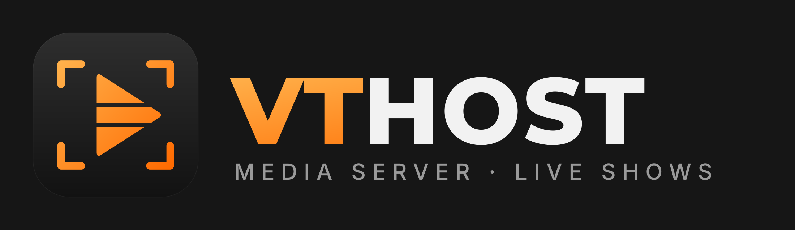

<p align="center"></p>

# VTHOST

**PT** · Player de vídeo para espetáculos (playlist de cues, estilo Mitti), em Windows. Feito para **nunca deixar o ecrã cair**: o motor de playback corre num processo próprio, é vigiado por um watchdog e retoma o show automaticamente se alguma coisa falhar.

**EN** · Show playback software (cue playlist, Mitti-style) for Windows. Built so that **the output never drops**: playback runs in its own process, is supervised by a watchdog and automatically resumes the show if anything fails.

Criado por / Created by **Daniel Nunes** — [github.com/NunesDanielPT](https://github.com/NunesDanielPT)

---

## Componentes / Components

| Executável | PT | EN |
|---|---|---|
| `vthost-studio.exe` | Interface (Qt 6): playlist de cues, preview, forma de onda, Inspector, countdown na rede, Show Mode | UI (Qt 6): cue playlist, preview, waveform, inspector, network countdown, Show Mode |
| `vthost-watchdog.exe` | Mantém o motor vivo: relança-o após crash ou bloqueio | Keeps the engine alive: relaunches it after a crash or hang |
| `vthost-engine.exe` | Motor sem interface: FFmpeg + Direct3D 11 + WASAPI, saídas em ecrã inteiro e NDI | Headless engine: FFmpeg + Direct3D 11 + WASAPI, fullscreen and NDI outputs |

Fechar ou crashar o Studio **não pára** o show. / Closing or crashing the Studio **does not stop** the show.

## Estabilidade / Stability

- Motor e interface em processos separados / Engine and UI in separate processes
- Watchdog com heartbeat: crash **ou** bloqueio → reinício com `--recover`, mesmo cue e posição / Heartbeat watchdog: crash **or** hang → restart with `--recover`, same cue and position
- Estado do show gravado de forma atómica 2×/s / Show state saved atomically twice per second
- Frame hold: se a descodificação atrasar, fica o último frame / If decoding stalls, the last frame stays up
- Ficheiros corrompidos dão erro na layer, não crash / Corrupted files error the layer, never crash
- Fallback para renderização por software (WARP) se a GPU falhar / Software rendering fallback if the GPU fails
- Sem protetor de ecrã, suspensão ou caixas de erro do Windows / No screensaver, sleep or Windows error dialogs
- Minidumps em `%LOCALAPPDATA%\VTHOST\crashes`, logs em `%LOCALAPPDATA%\VTHOST\logs`
- Show Mode: bloqueia edição e paragem do motor / locks editing and engine shutdown

## Instalar / Install

**PT** · Descarregue `VTHOST-Setup-x.y.z.exe` em [Releases](https://github.com/NunesDanielPT/VTHOST/releases/latest) e execute-o. Não precisa de permissões de administrador. O VTHOST Studio procura atualizações sozinho (*Definições → Geral*).

**EN** · Download `VTHOST-Setup-x.y.z.exe` from [Releases](https://github.com/NunesDanielPT/VTHOST/releases/latest) and run it. No admin rights needed. VTHOST Studio checks for updates automatically (*Settings → General*).

## Publicar uma versão / Release

1. Subir `VERSION` em `CMakeLists.txt` (ex. `0.2.0`) e fazer push para `main`. / Bump `VERSION` in `CMakeLists.txt` and push to `main`.
2. A CI vê que a release `v0.2.0` ainda não existe e publica-a com o instalador. / CI sees release `v0.2.0` doesn't exist yet and publishes it with the installer.
3. Os Studios instalados oferecem a atualização. / Installed Studios offer the update.

Commits sem mudança de versão não chegam aos PCs de espetáculo. / Commits without a version bump never reach show machines.

## Compilar / Build

Requisitos / Requirements: Windows 10/11 x64, Visual Studio 2022, CMake ≥ 3.24, Qt 6.8 (msvc2022_64).

```powershell
powershell -ExecutionPolicy Bypass -File scripts/fetch-deps.ps1   # FFmpeg (LGPL, shared)
cmake -S . -B build -G "Visual Studio 17 2022" -A x64 -DCMAKE_PREFIX_PATH=C:/Qt/6.8.3/msvc2022_64
cmake --build build --config Release
ctest --test-dir build -C Release
```

Os executáveis ficam em `build/bin`. Cada push para `main` gera uma build no GitHub Actions (artefacto `VTHOST-windows-x64`).
Executables end up in `build/bin`. Every push to `main` produces a build in GitHub Actions (`VTHOST-windows-x64` artifact).

## Documentação / Docs

- [Arquitetura / Architecture](docs/ARCHITECTURE.md)
- [Roadmap](docs/ROADMAP.md)

## Licença / License

Todos os direitos reservados — ver [LICENSE](LICENSE). / All rights reserved — see [LICENSE](LICENSE).
